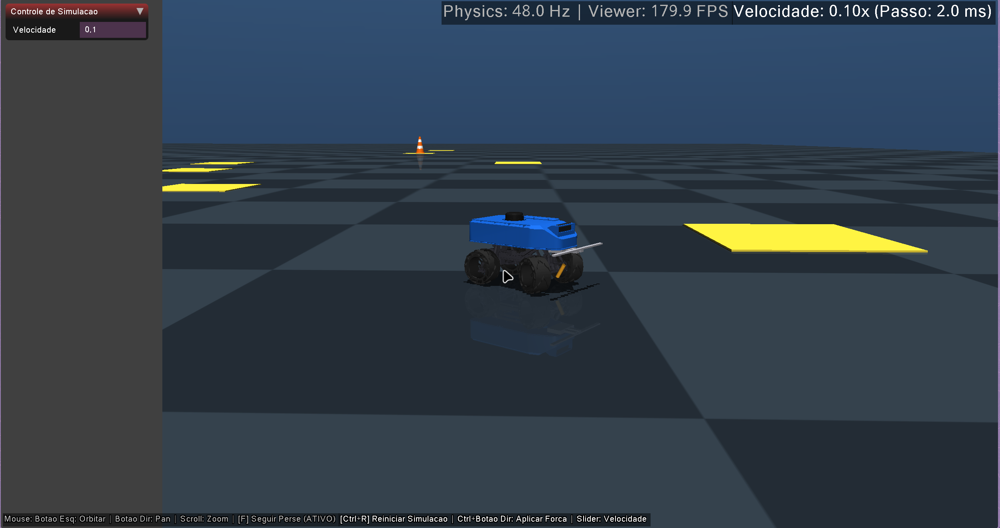
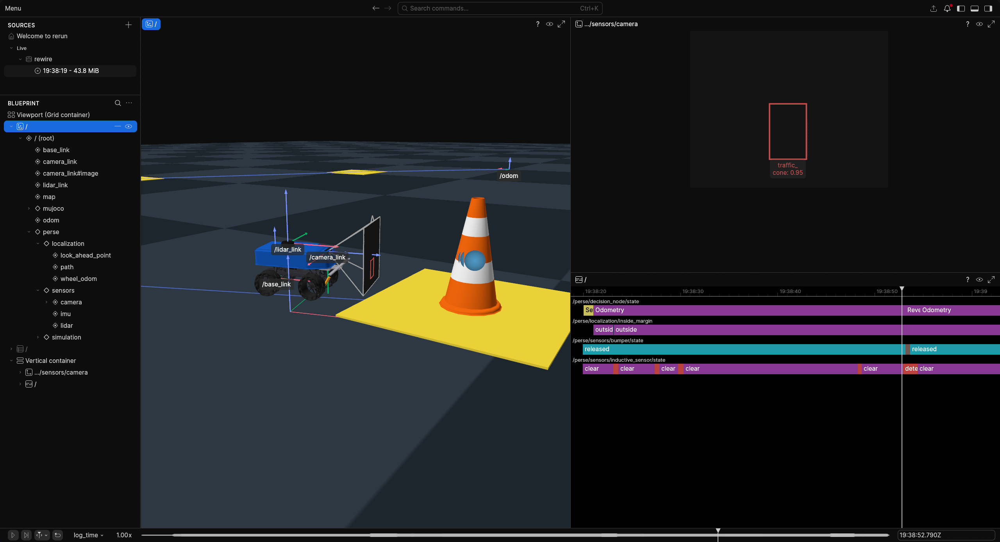

<h1 align="center">
    perse_mujoco - Simulação Física MuJoCo
</h1>

<p align="center">


</p>

<p align="center">


</p>

Pacote de simulação física baseada no **MuJoCo** para o robô **Perse**. Desenvolvido para substituir a antiga simulação do Webots (`perse_webots`), oferecendo desacoplamento completo de renderização (*headless* nativo em C++), dinâmica física realista de contato e suspensão, integração direta com **Rerun / Rewire** para visualização espacial 2D/3D e um servidor **MCP (Model Context Protocol)** para controle e inspeção por agentes de IA.

<p align="center">
  
  
</p>

---

## 🚀 Funcionalidades

- **Dinâmica Física Realista:**
  - Chassi com inércia real e suspensão independente nas 4 rodas.
  - Direção dianteira Ackermann com modelagem dinâmica de servos e tração traseira com resposta inercial de primeira ordem.
  - Parachoque frontal mecânico móvel com absorção elástica de impactos.
- **Sensores e Percepção Sintética:**
  - Emissão contínua de IMU, encoders de roda (fusão odometria), sensor indutivo de placas e bumper de colisão.
  - LiDAR 2D 360° analítico via raycasting (`mj_ray`).
  - Visão sintética analítica: detecção e projeção 2D de cones com frustum culling e teste de oclusão (`vision_msgs/msg/Detection2DArray`).
- **Visualização Flexível (Desacoplada):**
  - **Headless nativo:** física executada a 500 Hz sem depender de interface gráfica.
  - **Visualizador GLFW Nativo:** janela interativa desacoplada com controles padrão MuJoCo Studio.
  - **Visualização Rerun / Rewire:** streaming 3D de malhas e TFs sincronizados com a timeline `ros_time` e projeção Pinhole das caixas 2D da câmera.
- **Servidor MCP Integrado:** ferramentas para controle determinístico de tempo (`sim_step`), telemetria, aplicação de forças e captura de tela por agentes externos.

---

## 📁 Estrutura do Pacote

```
perse_mujoco/
├── config/                 # Parâmetros da simulação (perse_mujoco.yaml)
├── include/perse_mujoco/   # Headers C++ (declarações de interfaces e bridges)
├── src/                    # Implementação C++ dos nós e bibliotecas
│   ├── lib/                # Bridges de atuadores, sensores, visão, IPC e Rerun
│   ├── perse_mujoco_node.cpp    # Nó principal da física
│   ├── perse_mujoco_rerun.cpp   # Nó de streaming para o Rerun
│   └── perse_mujoco_viewer.cpp  # Janela interativa GLFW
├── model/                  # Arquivos MJCF (.xml), templates Xacro e malhas 3D (.obj, .stl)
├── launch/                 # Launch files (sim.launch, viewer.launch)
├── test/                   # Testes automatizados (física, renderização e ROS 2)
└── python/perse_mujoco/    # Map generator e servidor MCP
```

---

## 🛠️ Compilação

Dentro do container de desenvolvimento (`perse_container`):

```bash
# Compilar os pacotes
colcon build --symlink-install --packages-select perse_lib perse_localization perse_base perse_bringup perse_mujoco

# Carregar o workspace
source install/setup.bash
```

---

## 💻 Como Executar

### 1. Com Visualizador Nativo (GLFW)
Ideal para inspecionar colisões, forças e interagir com o robô pelo mouse:

```bash
ros2 launch perse_mujoco sim.launch gui:=true
```

#### Controles da Janela GLFW:
| Ação | Comando do Mouse / Teclado |
|---|---|
| **Rotacionar / Orbitar Câmera** | Clique e arraste com o **Botão Esquerdo** |
| **Transladar Câmera (Pan)** | Clique e arraste com o **Botão Direito** |
| **Zoom** | **Scroll** do mouse ou arraste com **Botão do Meio** |
| **Seguir o Robô Perse** | Tecla **`F`** (ativa/desativa o modo de acompanhamento) |
| **Reiniciar Simulação** | **`Ctrl + R`** (restaura posições e zera atuadores) |
| **Centralizar Ponto Focal** | **Duplo clique** sobre o objeto |
| **Aplicar Força no Objeto ("Corda")** | **Ctrl** + clique e arraste com o **Botão Direito** |

---

### 2. Com Rerun e Rewire (Visualização Espacial Completa)

O fluxo de visualização moderna do projeto utiliza o **Rerun Viewer** conectado ao bridge **`rewire`** (que converte tópicos ROS 2 em dados espaciais) e ao nó C++ `perse_mujoco_rerun` (que publica o modelo 3D do robô, imagem de fundo da câmera e matrizes Pinhole).

#### Fluxo de Execução Recomendado:

1. **Terminal 1: Iniciar o relay do rewire**
   ```bash
   rewire serve
   ```

2. **Terminal 2: Abrir a interface do Rerun**
   Conecte o visualizador Rerun ao servidor de relay:
   ```bash
   rerun ws://localhost:9876
   ```

3. **Terminal 3: Iniciar a simulação com Rerun ativo**
   Suba o launch desativando a janela nativa (`gui:=false`) e ativando o streaming para o Rerun (`rerun:=true`):
   ```bash
   ros2 launch perse_mujoco sim.launch gui:=false rerun:=true
   ```

> **Dica:** Ao rodar a stack completa do robô via `perse_bringup`, o bridge `rewire` já é orquestrado automaticamente em background caso o Rerun esteja habilitado:
> ```bash
> ros2 launch perse_bringup perse.launch sim:=true simulator:=mujoco gui:=false rerun:=true
> ```

---

## ⚙️ Parâmetros do Launch (`sim.launch`)

| Parâmetro | Tipo | Padrão | Descrição |
|---|---|---|---|
| `gui` | `bool` | `true` | Ativa a interface gráfica nativa GLFW do MuJoCo. |
| `rerun` | `bool` | `false` | Habilita o nó de streaming C++ para o Rerun Viewer (`perse_mujoco_rerun`). |
| `map_generator` | `bool` | `true` | Sobe o nó Python gerador de mapas e posicionamento de marcos de missão. |
| `model_path` | `string` | `""` | Caminho opcional para um arquivo MJCF customizado (se vazio, usa o modelo compilado do Perse). |
| `mission_points` | `string` | `mission_points.yaml` | Caminho do arquivo YAML com as coordenadas dos marcos e cones. |
| `use_sim_time` | `bool` | `false` | Define o uso de tempo de simulação (`/clock`) para os nós. |

---

## 🧪 Testes Automatizados

Com o workspace configurado, você pode rodar os testes unitários e de integração:

```bash
# 1. Testes unitários do modelo físico (suspensão, direção, tração e bumper):
python3 src/perse_mujoco/test/test_perse_model.py

# 2. Testes de integração ROS 2 (tópicos, sensores e dinâmica com simulação rodando):
python3 src/perse_mujoco/test/test_ros_bridge.py
```

---

## 🤖 Servidor MCP (Model Context Protocol)

O pacote disponibiliza um servidor MCP (`perse_mujoco_mcp`) que permite a clientes ou agentes de IA externos inspecionar a física e acionar comandos determinísticos via Model Context Protocol.

### Configuração do Servidor (`~/.gemini/config/mcp_config.json`):

```json
{
  "mcpServers": {
    "perse_mujoco": {
      "command": "docker",
      "args": [
        "exec",
        "-i",
        "-e",
        "PYTHONPATH=/home/thor/perse_ws/src/perse_mujoco/python",
        "perse_container",
        "python3",
        "/home/thor/perse_ws/src/perse_mujoco/python/perse_mujoco/mcp_server/server.py"
      ]
    }
  }
}
```

### Ferramentas Disponíveis:

- **Simulação:**
  - `sim_get_status`: Consulta tempo simulado, modo (`free_run`/`step_mode`), corpos e juntas.
  - `sim_step`: Executa deterministamente $N$ passos físicos e pausa.
  - `sim_pause` / `sim_resume`: Controla a execução da física.
  - `sim_reset`: Reinicia a física para $t = 0$.
  - `sim_get_bodies` / `sim_get_joints`: Inspeciona poses 3D, velocidades e deslocamentos das juntas.
  - `sim_apply_force`: Aplica forças ou torques externos pontuais a qualquer corpo.
- **Visualizador:**
  - `viewer_get_status` / `viewer_set_camera` / `viewer_focus_body`: Consulta e ajusta posição da câmera.
  - `viewer_set_option`: Ativa flags de debug visual (`contacts`, `joints`, `wireframe`, etc.).
  - `viewer_capture_screenshot`: Captura uma imagem da viewport nativa.
